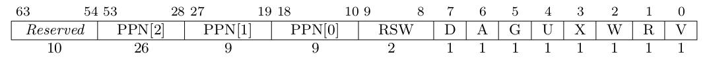

# ch4 实验报告

## 编程作业

- 共实现四个功能，思路如下：
  - `sys_get_time`: 根据 trap 之前任务的地址空间将虚拟地址转为对应物理地址（可能跨页，调用 `translate_byte_buffer`），判断可写之后写入当前时间；
  - `sys_trace`：和 ch3 中实现思路类似，注意需要转换读/写地址并检查权限；
  - `mmap`：先检查地址对齐等参数要求，然后判断是否存在已经被映射的页面，最后将连续的虚拟页映射为对应物理页；
  - `munmap`：同样检查地址对齐，然后判断要求取消映射的区间是否均已经映射了，最后将该区间全部取消映射；笔者一开始实现时没有想好怎么处理一个连续 `MapArea` 在操作后断开为两个的情况，尝试将后面一部分重新映射，但意识到这样需要迁移对应数据，成本非常高；事实上，应该只将后半段开辟为一个新的 `MapArea` 而不修改任何已有映射关系。

- 测试数据其实相当薄弱，只测试了相当简单的情况；另外，从本章开始系统安全的问题逐渐显现，例如对多个页面进行读写操作时每个页面都要进行权限检查，这在 `sys_get_time` 中或许尤其需要注意，如果发生跨页不可不对后几个字节进行检查。

## 简答作业

- 请列举 SV39 页表页表项的组成，描述其中的标志位有何作用？
  - 下图为 SV39 分页模式下的页表项[^1]
  
    其中 $[53: 10]$ 这 $44$ 位是物理页号，$[9: 8]$ 这 $2$ 位是 S 态软件（操作系统）保留位，最低的 $8$ 位 $[7: 0]$ 则是标志位，它们的含义如下（请注意，为方便说明，下文我们用 *页表项的对应虚拟页面* 来表示索引到一个页表项的虚拟页号对应的虚拟页面）：
    - V(Valid)：仅当位 V 为 1 时，页表项才是合法的；
    - R(Read)/W(Write)/X(eXecute)：分别控制索引到这个页表项的对应虚拟页面是否允许读/写/执行；
    - U(User)：控制索引到这个页表项的对应虚拟页面是否在 CPU 处于 U 特权级的情况下是否被允许访问；
    - G：这个映射在所有地址空间里都存在且相同，如 Trampoline 等；
    - A(Accessed)：处理器记录自从页表项上的这一位被清零之后，页表项的对应虚拟页面是否被访问过；
    - D(Dirty)：处理器记录自从页表项上的这一位被清零之后，页表项的对应虚拟页面是否被修改过。

    上述位可以被操作系统设置，只有 `A` 位和 `D` 位会被处理器动态地直接设置为 `1` ，表示对应的页被访问过或修过（ 注：`A` 位和 `D` 位能否被处理器硬件直接修改，取决于处理器的具体实现），`A` 和 `D` 会在页面置换的时候发挥作用，作为 Clock 等策略的判断依据。

[^1] 此处参考 [rCore-Tutorial-Book-v3 3.6.0-alpha.1 文档](https://rcore-os.cn/rCore-Tutorial-Book-v3/chapter4/3sv39-implementation-1.html)

- 缺页

  缺页指的是进程访问页面时页面不在页表中或在页表中无效的现象，此时 MMU 将会返回一个中断， 告知 os 进程内存访问出了问题。os 选择填补页表并重新执行异常指令或者杀死进程。
  - 请问哪些异常可能是缺页导致的？

    可能导致的异常有 `StorePageFault`，`LoadPageFault`，分别对应写和读；注意此时我们还没有处理取指缺页异常，这有待后续实现。

  - 发生缺页时，描述相关重要寄存器的值，上次实验描述过的可以简略。

    `sepc` 指向出现异常的指令，`scause` 则是对应上述四种异常之一的值，随后当前任务被标记结束，下一个任务即将开始；`trap_return` 中设置 `satp` 和 `stvec` 等寄存器的值以便于从 Trap 中退出并正确开始执行下一个任务；`stval` 中保存出现异常的虚拟地址，将来实现缺页异常处理之后，可以用其判断虚拟地址是否合法。

  缺页有两个常见的原因，其一是 Lazy 策略，也就是直到内存页面被访问才实际进行页表操作。 比如，一个程序被执行时，进程的代码段理论上需要从磁盘加载到内存。但是 os 并不会马上这样做， 而是会保存 .text 段在磁盘的位置信息，在这些代码第一次被执行时才完成从磁盘的加载操作。
  - 这样做有哪些好处？

    这样可以节约对内存的消耗，虽然我们有了虚拟地址，但物理内存毕竟容量有限，如果不够则只能降低任务执行效率或者使用虚拟内存等技术，但无论如何总会导致执行效率的下降，而 Lazy 策略则可以节约内存以延缓甚至避免这种情况的出现；另一方面，如果一部分数据或代码从始至终都没有被用到，Lazy 策略则可以切实地节约搬运这部分内容的时间。

  其实，我们的 mmap 也可以采取 Lazy 策略，比如：一个用户进程先后申请了 10G 的内存空间， 然后用了其中 1M 就直接退出了。按照现在的做法，我们显然亏大了，进行了很多没有意义的页表操作。

  - 处理 10G 连续的内存页面，对应的 SV39 页表大致占用多少内存 (估算数量级即可)？

    开销主要来自第三级页表（第二级是第三级的 $\frac{1}{512}$，可以忽略不计），一张第三级页表消耗 4K 的内存，可以管理大小为 2M 的虚拟地址空间，总开销为 $\frac{10\text{G}}{2\text{M}}\times 4\text{K} = \frac{10\text{G}}{512} = 20\text{M}$。

  - 请简单思考如何才能实现 Lazy 策略，缺页时又如何处理？描述合理即可，不需要考虑实现。
      
    内核中管理的任务的 `memory_set` 在任务 `mmap` 时先不进行分配，仅注册对应 `MapArea`，当任务读写/取指相应位置缺页触发异常陷入 Trap 后，内核再检查对应虚拟地址是否被注册/符合权限，之后再分配对应虚拟页；注意这样修改之后 `munmap` 的实现也需要进行修改。

  缺页的另一个常见原因是 swap 策略，也就是内存页面可能被换到磁盘上了，导致对应页面失效。

  - 此时页面失效如何表现在页表项(PTE)上？

    页表项(PTE)上该页面的 V 位为 0，从而使得处理器陷入 Trap，内核检查发现是一个合法页面后会将硬盘对应扇区的内容加载进内存里，然后再正常返回。

- 双页表与单页表

  为了防范侧信道攻击，我们的 os 使用了双页表。但是传统的设计一直是单页表的，也就是说， 用户线程和对应的内核线程共用同一张页表，只不过内核对应的地址只允许在内核态访问。 (备注：这里的单/双的说法仅为自创的通俗说法，并无这个名词概念，详情见 [KPTI](https://en.wikipedia.org/wiki/Kernel_page-table_isolation) )

  - 在单页表情况下，如何更换页表？

    由于所有线程都需要访问系统内核，所以都需要在自己的虚拟地址空间中对其进行映射，即系统内核应该在类似 KPTI Trampoline 的位置，这样正常陷入/离开内核态时无需更换页表， Trap 需要切换线程时将 satp 改为新线程的根页表，映射仍然连续。

  - 单页表情况下，如何控制用户态无法访问内核页面？（tips:看看上一题最后一问）
    
    将内核页面的 U 位设置为 $0$ 即可。

  - 单页表有何优势？（回答合理即可）
    
    仅在切换线程时需要更换页表，在因为系统调用等原因 Trap 进内核态时无需更换页表，TLB 刷新率更低，从而效率更高。

  - 双页表实现下，何时需要更换页表？假设你写一个单页表操作系统，你会选择何时更换页表（回答合理即可）？

    双页表实现下，任何 Trap 进入内核态的时候都需要更换页表，离开时也需要更换为上一个或下一个线程对应的页表；单页表操作系统中，可以类似 Trampoline 对操作系统内核进行一致映射，然后 Trap 在内核态切换线程时立即更新 satp，从另一个地址空间中继续访问内核代码/数据执行。

## Honor Code

- 在完成本次实验的过程（含此前学习的过程）中，我曾分别与 **以下各位** 就（与本次实验相关的）以下方面做过交流，还在代码中对应的位置以注释形式记录了具体的交流对象及内容：

  > 和 deepseek 关于理解本章内容等问题进行了交流，记录见 [lab1-session.v4.jsonl](./lab1-session.v4.jsonl)。

- 此外，我也参考了 以下资料 ，还在代码中对应的位置以注释形式记录了具体的参考来源及内容：

  > [rCore-Tutorial-Book-v3 3.6.0-alpha.1 文档](https://rcore-os.cn/rCore-Tutorial-Book-v3/chapter4/3sv39-implementation-1.html)

- 我独立完成了本次实验除以上方面之外的所有工作，包括代码与文档。 我清楚地知道，从以上方面获得的信息在一定程度上降低了实验难度，可能会影响起评分。

- 我从未使用过他人的代码，不管是原封不动地复制，还是经过了某些等价转换。 我未曾也不会向他人（含此后各届同学）复制或公开我的实验代码，我有义务妥善保管好它们。 我提交至本实验的评测系统的代码，均无意于破坏或妨碍任何计算机系统的正常运转。 我清楚地知道，以上情况均为本课程纪律所禁止，若违反，对应的实验成绩将按“-100”分计。